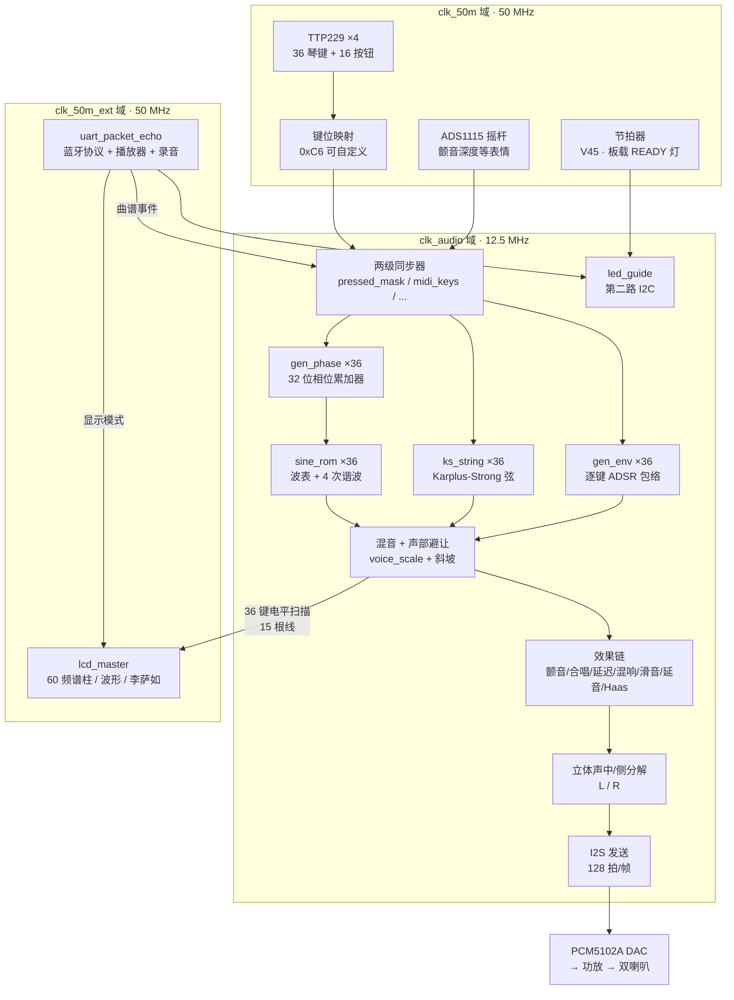

# 01 · 系统概述

> 本文建立整体印象：这是什么、跑在什么硬件上、信号怎么流。
> 所有框图都是 ASCII / Mermaid 内嵌，**不依赖任何外部图片文件**。

---

## 1. 项目定位

**一句话**：用 FPGA 内部逻辑**实时合成**声音的电子乐器——声音是"算"出来的，不是"放"出来的。

| 维度 | 本设计 | 常见对比方案 |
|---|---|---|
| 发声来源 | **Verilog 振荡器 + 物理建模，实时计算** | 存 WAV/MP3 采样回放 |
| 音频存储 | **0 字节音频采样** | 数十 MB ~ 数 GB |
| 复音 | **36 路真并行** | 分时复用 1 路 × 36 次 / 或软件合成 |
| 延迟 | **< 2 ms**（实测） | 软解码 + 缓冲通常 20 ms ~ 200 ms |
| 处理单元 | **无 CPU**：纯状态机 + 数据通路 | 软核 CPU 跑合成算法 |
| 效果器 | 延迟/混响/合唱/颤音**全在片内 BSRAM** | 外挂 DSP 芯片 |

**技术定位**：这是一个**数字信号处理的数据通路设计**——难点不在"跑算法"，
而在**把 36 条并行的实时信号链塞进一颗 60K 逻辑单元的 FPGA，并且让它的时序收敛**。

---

## 2. 硬件平台

### 2.1 主控与板卡

| 项目 | 内容 |
|---|---|
| FPGA | 高云 **GW5AT-LV60PG484AC1/I0**（器件 GW5AT-60，Device Version B） |
| 封装 | PG484，484 引脚 |
| 逻辑资源 | Logic 59904 / Register 60780 / BSRAM 118 块 / DSP 118 / PLLA 8 |
| 开发板 | **Console 60K**（= 赛题适配列表里的 Mega 60K） |
| 扩展板 | **自行设计、自行焊接**：36 键触摸键盘 + 36 颗 LED + 双 I2C + DAC 输出 |
| 输入时钟 | 板上 50 MHz 晶振 → `clk_50m`（V22） |
| 工具链 | Gowin V1.9.11.03 Education，命令行 `gw_sh.exe` |

### 2.2 外围器件清单

| 器件 | 型号 | 接口 | FPGA 引脚 | 作用 |
|---|---|---|---|---|
| 电容触摸键盘 ×3 | **TTP229**（16 位模式） | 自定义 2 线（SCL/SDO） | 琴键1 `scl=C22/sdo=F18`<br>琴键2 `scl2=E21/sdo2=E22`<br>琴键3 `scl3=B22/sdo3=E18` | 36 个琴键，每片 12 键 |
| 按钮板 ×1 | **TTP229**（16 位模式） | 同上 | `scl_btn=E13/sdo_btn=E14` | 16 个功能按钮 |
| 音频 DAC | **PCM5102A** | **I2S** | `bck=A20 / lck=A16 / din=A15` | 立体声 D/A |
| 显示屏 | **ST7789** 320×240 | SPI | `lcd_sck=D22 / lcd_mosi=F20 / lcd_dc=W19 / lcd_cs=W20 / lcd_blk=F19` | 频谱/波形/李萨如 |
| LED 驱动 | **IS31FL3236A** | **I2C（第二路，独立）** | `led_scl=V17 / led_sda=W17` | 36 颗 LED 演奏指引，从机地址 `0x3C` |
| 摇杆 ADC | **ADS1115** | **I2C（第一路）** | `i2c_scl=G22 / i2c_sda=V19` | 颤音深度等表情控制 |
| 蓝牙模块 | HC-05/06 | **UART** | `uart_txd=W22 / uart_rxd=W21` | 9600 8N1，曲谱/状态/录音 |
| 板载 LED ×2 | — | GPIO 复用 | `led=U12`（READY，V45 起作**节拍器**）<br>`led_glide=G11`（DONE，滑音/延音指示） | 状态指示 |
| 测试脚 ×2 | — | GPIO | `lat_key=C19` / `lat_pcm=C18` | 延迟测量（接示波器） |

> ★ **两路 I2C 是完全独立的总线**，不要混淆：
> ADS1115 走 `G22/V19`，LED 指引走 `V17/W17`。
> 这样设计的理由：摇杆采集（clk_50m 域）和 LED 刷新（clk_audio 域）互不阻塞。

### 2.3 引脚约束的两套并列版本

工程里有**两份并列的引脚约束**，同一时刻只能启用一份：

| 文件 | 用途 | 差异 |
|---|---|---|
| `src\music.cst` | **调试版**（答辩用这套） | — |
| `src\music_release.cst` | **实装版（交付用）** | 差 8 个引脚（实装 PCB 的走线） |

差别仅在于 UART 与三组琴键引脚的**位置轮换**（实装 PCB 就是这么布的）。
切换脚本：`pwsh -File tools\build_with_cst.ps1 -Mode release|debug`。
**本材料中所有资源/时序数据均来自 `music.cst`（调试版）的构建。**

---

## 3. 系统框图

### 3.1 顶层结构



### 3.2 时钟树（PLL 配置）

```
板上晶振 50 MHz (V22)
   │
   ├──────────────────────────────► clk_50m          50.000 MHz
   │                                触摸扫描 / 效果寄存器 / 摇杆 / 节拍器 / 测试脚 T1
   │
   └──► PLLA  (MDIV = 14  →  VCO = 700 MHz)
            │
            ├── CLKOUT0  ÷ 56  ──► clk_audio         12.500 MHz   ★ 音频域
            │                     合成 / 包络 / 效果 / I2S / LED 指引
            │
            └── CLKOUT1  ÷ 14  ──► clk_50m_ext      50.000 MHz
                                  UART(蓝牙) / LCD

采样率  fs = 12.5 MHz ÷ FRAME_DIV = 12.5e6 ÷ 128 = 97656 Hz
              FRAME_DIV = FRAME_BITS(64) × BCLK_HALF(1) × 2 = 128
UART    波特 = 50 MHz ÷ BAUD_DIV(5208) = 9600 8N1
```

**为什么采样率必须是 97656 Hz**：音频域每 128 个时钟产生一个新样本，
而 I2S 一帧也正好是 128 个音频时钟（64 bit 帧 × 每 bit 2 个时钟 × 左右两声道）。
两者**一一对齐**——DAC 每帧取一次数，音频域每帧正好给一个新数，
既不会连发两遍也不会漏掉。若 `SAMPLE_RATE_HZ` 与真实交付给 DAC 的采样率不等，
频率字会整体偏移，所有音都会走调。

### 3.3 三个时钟域之间的跨域信号（两级同步器 / 翻转沿握手）

| 信号 | 方向 | 同步器 | 性质 |
|---|---|---|---|
| `pressed_mask` | 50M → audio | `pressed_mask_sync1/2` | 按键位掩码（准静态） |
| `sustain_on` | 50M → audio | `sustain_s1/s2` | 开关状态 |
| `timbre_toggle_50m` | 50M → audio | `tt_d1/d2/d3` | 翻转沿 + 数据握手 |
| `event_toggle` | 50M → audio | `event_toggle_d1/d2/d3` | 翻转沿 + 数据握手 |
| `glide_en` | 50M → audio | `glide_s1/s2` | 开关状态 |
| `auto_keys` / `midi_keys` | 50M → audio | `*_s1/s2` | 按键位掩码（准静态） |
| `midi_octs` / `midi_vel` | 50M → audio | `*_s1/s2` | 准静态（整个事件期间不变） |
| `metro_beat` | 50M → ext | 两级同步 | 仅用于状态回报 |
| `disp_tgl` / `disp_val` | ext → 50M | `dsp_s1/s2/s3` | ★ V48：翻转沿 + 数据握手（上位机设显示模式） |
| `dsp_rep_tgl` / `dsp_rep_lat` | 50M → ext | `dsp_t_s1/s2/s3` | ★ V48：翻转沿 + 数据握手（回报显示模式） |
| `sounding_mask_gate` → `rec_mask_s1/s2` | audio → ext | **源域先打一拍** + 两级同步 | ★ V48.3：录音门控掩码。原来 `rec_mask_s1` 的 D 端直接接纯组合的 `sounding_mask_aud`，形成"跨两域、四层组合"的长链，实测 setup slack **-0.155 ns**；在音频域加 `sounding_mask_gate` 后跨域段变成"寄存器 → 寄存器"，违例端点 **1 → 0**（代价：门控晚 80 ns，录音时标是 ms 级，无感） |

> ★★ **V48 这两条为什么必须用握手、不能用两级同步器**：
> 显示模式是 **3 位**，而相邻档之间会**同时翻两位**（`1 -> 2` 是 `001 -> 010`）。
> 直接的位同步器有可能"有的位已经翻、有的还没翻"，采到 **`000`（频谱）**
> 或 **`011`（= 3，非法码）**这种中间态。而 `0x5F` 状态帧是**"变了就发"**，
> 假帧一旦发出去就收不回来 —— 上位机会把控件切到错的档位。
> 握手的前提是"**数据先稳定、翻转沿晚到**"：接收侧在沿上锁存时，
> 数据已经稳定了 2~3 个周期。`04` 案例 3 就是这个纪律的来源。

> ★ **设计纪律**：跨时钟域的信号**必须是准静态的**（变化后至少稳定几十个周期才被采样），
> 或者走"数据先稳定、翻转沿晚 1~2 拍"的握手。凡是不满足这两条的跨域，
> 都会出现"接收侧两条同步链谁先到看布线"的随机错误——本工程在
> **V36→V37 期间踩过这个坑**（表现为"按谐波结果翻了滑音"，见 `04` 案例 3）。
>
> ★★ **V48.3 补的第三条纪律**：**跨域信号要在源域先打一拍再跨**。
> 长组合链（哪怕终点是"两级同步器的第一级"）本身就是一个时序瓶颈 ——
> 它跨域时会被当成"20 ns 内必须走完"的路径，而**布局一扰动就可能翻车**
> （V48.3 实测 -0.155 ns）。先在源域寄存一拍，跨域那段就只剩布线延迟。

在 `music.sdc` 中这三个域被声明为**异步**：

```tcl
set_clock_groups -asynchronous -group [get_clocks {clk*}]
```

**原本的意图**：工具不再对跨域路径做 setup/hold 检查。
**加这条之前**（没有 SDC 时）工具会把 50 MHz 域和 12.5 MHz 音频域当成**同步域**去算，
于是报出一堆跨时钟同步器的 HOLD 违例（最差 **-1.367 ns**，端点全是
`pressed_mask_sync1` / `tr_audio_r` / `event_toggle_d1` 这些两级同步器的第一级）——
这些路径本来就该被排除，负 slack 是**假违例**。

> ★★ **但 V48.3 发现：这句通配其实没圈住 PLL 派生时钟** ——
> 派生时钟的真实名字是 `u_pll/u_pll_0/PLLA_inst/CLKOUT0.default_gen_clk`
> （`CLKOUT1` 同理），**不以 `clk` 开头**，所以 `clk*` 只圈到了 `clk_50m`。
> 证据：STA 报告里仍然能查到 `CLKOUT0 -> CLKOUT1` 的跨域路径被分析 ——
> V48.3 第一次构建正是靠这些路径暴露出 **1 个 setup + 6 个 hold 违例端点**
> （TNS 汇总表里看不见，见 `02` §5.1）。
> ★ 结论：跨域这些"假违例"**一直是靠碰巧有正余量在过关**。
> 我们的处理是**不碰 SDC（项目红线）**，改在 **RTL 侧把跨域链修短**：
> 新增一条设计纪律 —— **跨域信号必须在源域先打一拍再跨**，
> 不许让一条长组合链直接扎进同步器第一级
> （上表最后一行 `sounding_mask_gate` 就是这条纪律的产物，详见 `02` §5.5）。

---

## 4. 信号流：从手指到声音

完整的九段链路，含每段的**所在时钟域**和**代价**：

```
 ①  手指触摸琴键
     └─ TTP229 内部检测电容变化（器件固有，不受 FPGA 控制）
                    │
 ②  触摸扫描读取                              【clk_50m 域】
     └─ ttp229_reader.v：SDO 高 93µs → 低 10µs 启动
        → 打 16 个 SCL（100 kHz，半周期 5µs）逐位读
        → 等 2ms 稳定窗口 → 锁存完整读数
     └─ 扫描周期 = 93 + 10 + 160 + 2000 ≈ 2.26 ms
        ★ 只在 WAIT_2MS 第一拍锁存（避免读到"半成品"掩码 → 虚报一片键）
                    │
 ③  2/2 去抖                                  【clk_50m 域】
     └─ 连续两轮读数一致才承认变化
     └─ 代价：按下/松开各晚约 2.26 ms（人的触感无感知）
        ★ 目的：滤掉单轮坏读数（LCD 的 SPI 时钟紧挨 scl/sdo）
          单轮坏读数会造成 env 清零 → 键位恢复后重弹一次（"回声"）
                    │
 ④  键位映射                                  【clk_50m 域】
     └─ key_map[]：TTP229 接线顺序 → 逻辑键号（0xC6 蓝牙可改）
     └─ 手弹 / 自动演奏 / MIDI / 蓝牙 四路掩码 OR 成 key_mask
                    │
 ⑤  跨时钟域同步（两级同步器）                  50 MHz → 12.5 MHz
     └─ pressed_mask_s1/s2；key_new = key_mask & ~key_mask_d（按下瞬间的单拍脉冲）
                    │
 ⑥  起音 + 相位累加 + 包络                     【clk_audio 域】
     └─ 起音那一拍：phase ← 0（音头从 sin(0)=0 开始，干净）、
        dcur ← 上一个音的频率字（滑音起点）
     └─ 每采样点：phase += inc[g]
        inc[g] = delta[g] × 移调比例 >> 八度偏移
        delta[g] = freq[g] × 2^32 ÷ 97656   ← 编译期常数，不烧加法器
     └─ gen_env：attack → decay → sustain → release，每键独立状态机
                    │
 ⑦  波表 + 谐波混合                            【clk_audio 域】
     └─ 一个采样周期内读【同一张表】3 次，取到 4 个谐波：
        cnt=0/1 → 基波 + 2 次谐波（同一地址的高/低半字）
        cnt=2/3 → 3 次谐波（地址 (3P)[31:24]）
        cnt=4/5 → 4 次谐波（地址 P[29:22]）
     └─ 谐波在【包络之后】混合 → 因式分解保留 → 力度只需 1 个全局乘法器
                    │
 ⑧  混音 + 效果链                              【clk_audio 域】
     └─ 声部避让：voice_scale(n_voice) → mix_scale_r 斜坡（每采样点走 1 步）
     └─ 颤音 / 合唱 / 延迟 / 混响 / Haas 展宽 / 滑音 / 延音锁存
     └─ 中/侧分解 → st_l / st_r
                    │
 ⑨  I2S 装载 + 发送                            【clk_audio 域】
     └─ i2s_load = {st_l[15:0], 16'b0}（左对齐，标准 I2S 补 1 个 BCK 空位）
     └─ 每帧 128 个音频时钟，BCK 64×fs
                    │
 ⑩  PCM5102A DAC → 功放 → 双喇叭
```

---

## 5. 模块清单（参与综合的 13 个 Verilog 文件）

| 文件 | 行数 | 时钟域 | 职责 |
|---|---:|---|---|
| `src\top.v` | 4716 | 全部 | **主逻辑**：PLL 例化、36 声部合成、效果器、I2S、子模块例化；`ks_string` 模块在文件末尾 |
| `src\uart_packet_echo.v` | 1963 | clk_50m_ext | 蓝牙协议收发、乐谱播放器、录音回传、效果/音色/映射/八度/力度写口 |
| `src\lcd_master.v` | 1809 | clk_50m_ext | ST7789 320×240：清屏、60 频谱柱、波形、李萨如、数字显示 |
| `src\pll_init.v` | 340 | — | PLLA 例化与参数（MDIV=14，CLKOUT0 ÷56，CLKOUT1 ÷14） |
| `src\led_guide.v` | 323 | **clk_audio** | 36 颗 LED 演奏指引，第二路 I2C，四档亮度 |
| `src\uart_tx_ads.v` | 262 | clk_50m | ADS1115 采集上报（当前未例化，保留） |
| `src\i2c_master.v` | 222 | clk_audio | I2C 主机（只做"写一个寄存器"），驱动 IS31FL3236A |
| `src\ads1115_ctrl.v` | 422 | clk_50m | ADS1115 四通道 ADC 采集（摇杆） |
| `src\ttp229_reader.v` | 168 | clk_50m | 单片 TTP229 读取器（参数化 12/16 位） |
| `src\uart_rx.v` | 131 | clk_50m_ext | UART 接收（带单位采样抗噪 + 三次采样多数表决） |
| `src\sine_rom.v` | 95 | clk_audio | 波表 ROM：64×16 四分之一正弦 + 象限折叠，1 拍读延迟 |
| `src\uart_tx.v` | 69 | clk_50m_ext | UART 发送 |
| `src\uart.v` | 45 | — | 简易 UART（保留，未例化） |

> ★ `top.v` 的 `module` 声明到 `endmodule` 是 4716 行（第 4 行 ~ 第 4808 行），
> 之后第 4856~5051 行是 `ks_string` 模块——它**不单独成文件**。

---

## 6. 四种音色

| 音色 | `0xCA` 参数 | 实现方式 | 特点 |
|---|---|---|---|
| **普通** | `0` | 波表合成 + 谐波叠加，`env_sus_lv = 255`（不衰减） | 持续音色，适合旋律 |
| **笛子** | `1` | 波表合成，起音放慢（`ENV_ATK_DIV_FLUTE = 46`），保持电平 `200`（-2 dB） | 柔和、有吹奏起音感 |
| **吉他** | `2` | **Karplus-Strong 物理建模**（`ks_string` ×36） | 拨弦衰减，泛音自然 |
| **小号** | `3` | 波表合成；**在"力度给的那份 2 次谐波"之上，再垫一层固定的 2 次谐波**（`harm_brass = harm_raw + (S2 >>> 2)`）；起音 `ENV_ATK_DIV_TRP = 4`（约 2.6 ms 起振）、保持满幅、释音比普通短一半 | ★ 铜管感：**吹多轻都一直是亮的**，且摇杆/MIDI 力度**照样还能调亮度** |

> ★ **为什么小号要"垫一层固定的谐波"**：这个设计的"亮度"只有一个旋钮 ——
> 2 次谐波的量，由力度（velocity）给。普通音色的行为是"力度小就柔和"；
> 而铜管的特点是**不管吹多轻都一直是亮的**，所以给小号一个固定的"铜管底色"，
> 力度那一份继续叠加在上面，亮度仍然可调，但**不会一轻就退回纯正弦**。
> ★ 资源上**没有新增任何位宽**：`tone_sel` 本来就是 2 位，4 档刚好装下；
> 整版只涨 **+52 LUT / +72 FF**。
> ★ 四档的音色译码只改了一处 `trumpet_on = (tone_sel == 2'd3)`，
> **另外三档逐位不变**（`env_*` 四个三目都把"小号"那一支写在最后，
> `trumpet_on_audio = 0` 时取回的就是原来的表达式）。

### Karplus-Strong 弦模型的实现要点（`ks_string`，`top.v` 末尾）

```
噪声激励（LFSR）→ 灌满一圈延迟线（Ni 点）
      ↓
延迟线读出两个相邻点 r0 / r1
      ↓
线性插值：xi = r0 + ((r1-r0) × FR) >> 6      ← FR 是 6 位常数？
      ↓
环路低通：y = (xi + xi_prev) >> 1           ← 每圈衰减一次，高频衰减更快
      ↓
阻尼：y2 = y - (y >> DP)
      ↓
带饱和地写回延迟线
```

| 实现细节 | 做法 | 为什么 |
|---|---|---|
| 延迟线存储 | `(* syn_ramstyle = "block_ram" *) reg signed [15:0] ram [0:511]` | 强制落进 BSRAM，**36 条弦 = 36 块**，不烧 LUT |
| 弦长 | `NI_TAB(KEY)` 是 `localparam` **常数** | 常数才能让插值系数 FR 也常数化 |
| 插值乘法 | `dif × FR` 用**移位相加**展开（6 级 ALU） | 实测：改成 `dif * FR` 会让 DSP 从 53.5 涨到 **104.5 / 118（89%）**，太满 |
| 起振噪声幅度 | `nz × vel[7:4]` 用**移位相加**（4 级 ALU） | 原写法 36 条弦各吃一个 `MULT12X12`（占 DSP 的 61%），换掉后腾出 DSP 余量 |
| 时序安排 | 每采样点用 `sample_cnt[7:0]` 的 0~7 拍走一个 8 拍流水 | 一条弦每采样点只算一次，36 条弦共享 128 拍的帧周期，绰绰有余 |
| 非吉他音色 | `run = 0` → 整条弦冻住，写使能清掉 | 省功耗，且不干扰其他音色 |

> ★ 这里体现了本设计的核心取舍：**DSP 是稀缺资源（只有 118 个），LUT 相对富裕**。
> 凡是"小常数乘法"一律用移位相加换成 LUT，把 DSP 留给真正需要的地方。

---

## 7. 系统功能面（赛题对照速查）

| 功能 | 状态 | 实现位置 |
|---|---|---|
| 纯硬件实时合成（零 PCM） | ✅ | `top.v` |
| 复音 36（要求 ≥4 / ≥32） | ✅ | 36 路并行振荡器 |
| 波表 + 物理建模两种合规算法 | ✅ | `sine_rom.v` / `ks_string` |
| **4 种音色** | ✅ | 普通 / 笛子 / 吉他 / **小号**（`0xCA` 参数 0~3） |
| ≥3 维表情控制 | ✅ | 摇杆 X（移调）· 摇杆 Y（音量）· 颤音深度 · 滑音 · 延音 |
| 混响 / 延迟 / 合唱全在片内 | ✅ | `rvb_m1~m3` / `dly_mem` / `cho_ma,mb` |
| 可视化：**5 种显示模式**（频谱 / 波形 / 李萨如 ×3） | ✅ | `lcd_master.v`（60 根频谱柱；★ 黑键列亮青 `0x07FF` / 白键列亮红 `0xF800`） |
| 蓝牙 App：曲谱播放 / 键位自定义 / 录音回传 / 效果音色控制 | ✅ | `uart_packet_echo.v` + 电脑版/安卓版上位机 |
| **36 键电容触摸 + 物理琴键顺序映射** | ✅ | `ttp229_reader.v` + `led_guide.ch2key()` |
| **36 颗 LED 演奏指引（四档亮度）** | ✅ | `led_guide.v`（第二路 I2C） |
| **跟谱模式（按对才前进）** | ✅ | `0xCE` + `uart_packet_echo.v` |
| **MIDI 逐音力度** | ✅ | `0xC3` + `top.v gen_env` 包络峰值 |
| **节拍器** | ✅ | V45，板载 READY 灯 |
| **端到端延迟可出示证据** | ✅ | `lat_key=C19` / `lat_pcm=C18` + 示波器 |
| Mega 60K 板卡 | ✅ | GW5AT-LV60PG484AC1/I0 |
